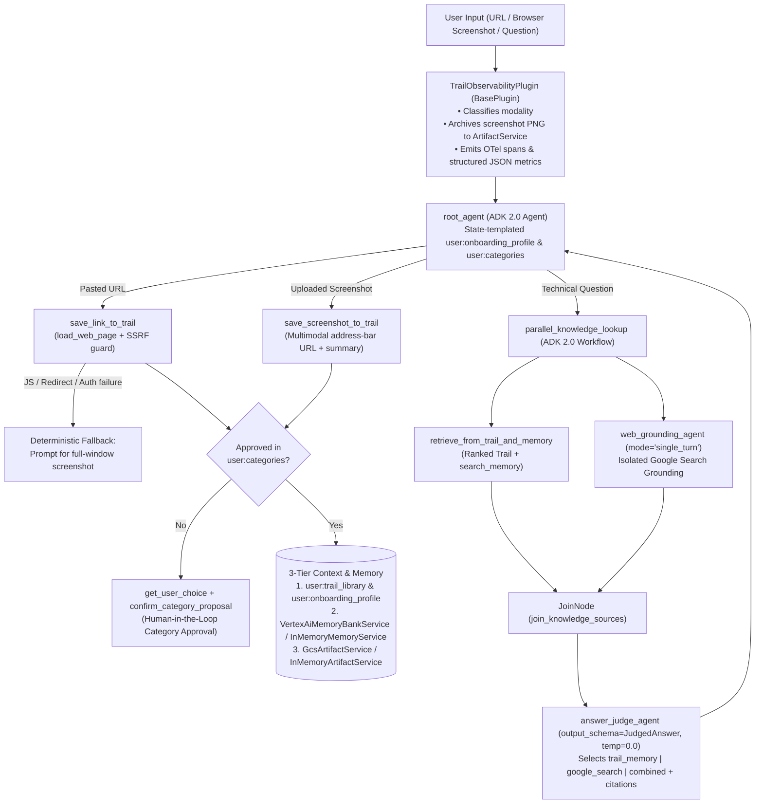

# Personal Onboarding Trail Agent

**Track:** Concierge / Enterprise Productivity Agents  
**Framework:** Google Agent Development Kit (ADK 2.0, Python) + Vertex AI Agent Runtime + A2A Protocol

## Problem & Solution

* **Problem:** Engineers onboarding onto a new technical stack read dozens of public documentation pages, GitHub repositories, and tutorials across weeks. Manually typing notes breaks flow, browser history buries important pages under noise, and standard chat assistants have no memory of which pages you already studied or what your open onboarding goals are.
* **Solution:** The **Personal Onboarding Trail Agent** is a zero-typing daily onboarding assistant. Paste a URL or upload a full-window browser screenshot with no extra text: the agent fetches or visually extracts the source URL, title, summary, and takeaways, categorizes it against your governed category list (pausing for human approval before adding a new category), and builds a persistent cross-session memory of your reading trail and onboarding profile. When you ask a question, an ADK 2.0 `Workflow` graph queries your **Personal Trail & Memory Bank** and **Live Google Search** in parallel, then runs a structured **Judge Agent** to return the stronger cited answer.

---

## Architecture



---

## Mapping to Assessment Evaluation Criteria

| Criterion | Implementation in This Repository | Key Files |
| :--- | :--- | :--- |
| **1. Tool & Interface Design** | Six single-responsibility typed `FunctionTool`s with Pydantic `BaseModel` validation (`TrailEntry`, `OnboardingProfile`, `KnowledgeQueryInput`, `JudgedAnswer`), `ToolContext` state isolation, deterministic `fetch_failed` -> screenshot fallback, `get_user_choice` (`LongRunningFunctionTool`) for zero-typing approval, and an A2A (`Agent2Agent`) JSON-RPC + `/.well-known/agent-card.json` server interface. | `app/tools.py`, `app/schemas.py`, `app/app_utils/a2a.py` |
| **2. Context & Memory** | Three complementary persistence layers: (1) `user:`-prefixed session state (`user:trail_library`, `user:categories`, `user:onboarding_profile`) injected via `{user:...}` instruction templates plus `EventsCompactionConfig`; (2) cross-session semantic recall via `VertexAiMemoryBankService` (Agent Runtime) / `InMemoryMemoryService` (local) automatically synced on `after_run_callback` and queried via `load_memory` & `ctx.search_memory`; (3) screenshot binary archival via `GcsArtifactService` / `InMemoryArtifactService` + `load_artifacts`. | `app/tools.py`, `app/app_utils/services.py`, `app/observability.py`, `app/agent.py` |
| **3. Orchestration & Logic** | Combines conversational multimodal routing on `root_agent` with an explicit ADK 2.0 `Workflow` DAG (`parallel_knowledge_lookup`): concurrent tuple fan-out to `retrieve_from_trail_and_memory` and an isolated `mode="single_turn"` `web_grounding_agent` (preventing Gemini `google_search` + function-tool `400 INVALID_ARGUMENT` conflicts), synchronization at `JoinNode`, and deterministic evaluation by `answer_judge_agent` (`output_schema=JudgedAnswer`, `temperature=0.0`), plus `ResumabilityConfig(is_resumable=True)` and `ReflectAndRetryToolPlugin`. | `app/workflows.py`, `app/agent.py` |
| **4. Observability & Tracing** | Custom stateless `TrailObservabilityPlugin(BasePlugin)` recording custom OpenTelemetry spans (`onboarding_trail.user_message`, `onboarding_trail.agent.*`, `onboarding_trail.tool.*`, `onboarding_trail.workflow.*`), per-tool latency (`duration_ms`), token usage (`prompt_token_count`, `candidates_token_count`, `thoughts_token_count`), judge source selection metrics, and structured JSON logs for Cloud Logging alongside Cloud Trace export (`otel_to_cloud`). | `app/observability.py`, `app/fast_api_app.py` |
| **5. Infrastructure & CI/CD** | Production multi-stage `Dockerfile`, Terraform IaC (`deployment/terraform/`) targeting Vertex AI Agent Runtime with least-privilege IAM and Cloud Storage telemetry buckets, GitHub Actions pipelines (`pr_checks.yaml` for Ruff linting + offline `pytest` unit/workflow tests + gated WIF cloud integration tests, `staging.yaml`, and `deploy-to-prod.yaml`), load tests (`tests/load_test/`), and LLM-as-judge evaluation suite (`tests/eval/`). | `Dockerfile`, `deployment/terraform/`, `.github/workflows/`, `tests/` |

---

## Project Structure

```text
.
├── app/
│   ├── agent.py                 # Root ADK 2.0 Agent, App config, plugins, compaction & resumability
│   ├── schemas.py               # Pydantic schemas (TrailEntry, OnboardingProfile, JudgedAnswer)
│   ├── tools.py                 # Typed link/screenshot capture, category governance & search tools
│   ├── workflows.py             # ADK 2.0 parallel fan-out + JoinNode + Judge Workflow graph
│   ├── observability.py         # OpenTelemetry spans & TrailObservabilityPlugin (BasePlugin)
│   ├── fast_api_app.py          # FastAPI entrypoint (ADK SSE, Dev UI, A2A, Reasoning Engine adapter)
│   └── app_utils/               # Shared Session/Artifact/Memory services & A2A/Runtime adapters
├── deployment/terraform/        # Terraform IaC for staging/prod & CI/CD Workload Identity
├── .github/workflows/           # GitHub Actions (pr_checks.yaml, staging.yaml, deploy-to-prod.yaml)
├── tests/
│   ├── unit/                    # Offline deterministic unit & workflow tests (ScriptedLlm + InMemoryRunner)
│   ├── integration/             # Live streaming, A2A agent-card, and Reasoning Engine E2E tests
│   ├── eval/                    # Offline evaluation dataset & LLM-as-judge rubric
│   └── load_test/               # Locust load tests
├── Dockerfile                   # Container build for Cloud Run / Agent Runtime
└── pyproject.toml               # Dependencies, Ruff lint rules, and pytest configuration
```

---

## Quickstart

### 1. Prerequisites & Installation

Requires Python 3.11–3.13 and [`uv`](https://docs.astral.sh/uv/).

```bash
uv sync --group dev --extra lint
```

Copy `.env.example` to `.env` and set either your Google Cloud project (Vertex AI / Gemini Enterprise Agent Platform) or a Gemini API key:

```bash
cp .env.example .env
# Edit .env:
# GOOGLE_GENAI_USE_ENTERPRISE=true
# GOOGLE_CLOUD_PROJECT=your-gcp-project-id
# GOOGLE_CLOUD_LOCATION=global
```

### 2. Run Locally in the Playground

```bash
agents-cli playground
# Or directly with ADK:
uv run adk web . --port 8000
```

Try these three flows in the UI (`http://127.0.0.1:8000/dev-ui/?app=app`):
1. **Zero-typing Link Capture:** Paste `https://github.com/google/adk-python` and press Enter.
2. **Zero-typing Screenshot Capture:** Click `+` -> **Upload local file** and attach a full-window screenshot of any public technical doc (including the browser address bar).
3. **Parallel Trail + Web Q&A:** Ask *"How do the four session state prefixes work in Google ADK, and what have I saved so far?"*

### 3. Run Linter, Unit Tests, and Evaluations

```bash
# Lint & offline unit/workflow tests (no cloud credentials required)
uv run ruff check app tests/unit tests/integration
uv run pytest tests/unit -v

# Live integration tests (requires active ADC / API key)
uv run pytest tests/integration -v

# Run LLM-as-judge evaluation suite
agents-cli eval run
```

### 4. Deploy to Vertex AI Agent Runtime

```bash
agents-cli deploy
```
